# Manual – Reto 10: Consumiendo Webservices del Catálogo de Datos Colombiano

**App:** Puntos Posconsumo · **Autor:** Luis Alberto Castillo Sanabria · **Plataforma:** Android (Kotlin + Jetpack Compose)

Este documento tiene dos partes:

1. [Manual de uso](#parte-1--manual-de-uso): cómo se usa cada función de la aplicación.
2. [Cómo se desarrolló](#parte-2--cómo-se-desarrolló): pasos, decisiones técnicas y código principal.

Todos los pantallazos se tomaron en el emulador **Pixel 8** de Android Studio.

---

## Parte 1 – Manual de uso

### 1.1 Iniciar la aplicación

Al abrir la app aparece la pantalla de carga de Android y luego la pantalla principal.
Al iniciar, la app hace **3 peticiones** al servicio web:

1. Pide la lista de **municipios** distintos que tienen puntos de recolección.
2. Pide la lista de **tipos de residuo** distintos.
3. Hace una primera consulta sin filtros (50 resultados como máximo).

| Pantalla de carga | Pantalla principal |
|---|---|
| 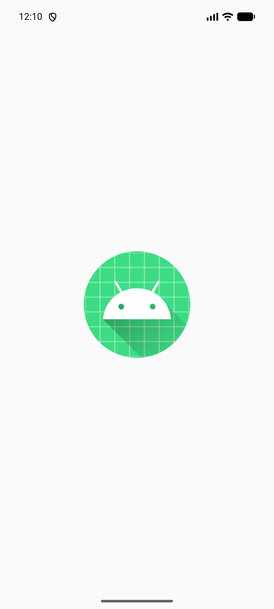 | 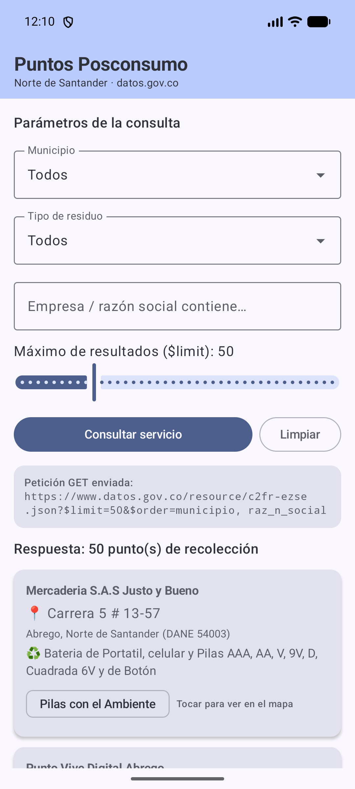 |

La pantalla principal tiene dos zonas:

- **Parámetros de la consulta** (arriba): los filtros que se le envían al servicio.
- **Respuesta** (abajo): la petición GET que se envió, el número de resultados y una tarjeta por cada punto de recolección.

### 1.2 Filtrar por municipio

1. Toca el campo **Municipio**. Se abre una lista con *Todos* y los 25 municipios que trajo el servicio.
2. Elige un municipio (por ejemplo, *Ocaña*).
3. Pulsa **Consultar servicio**.

En el recuadro **Petición GET enviada** aparece el parámetro `$where=municipio='Ocaña'`, y la respuesta trae solo los puntos de ese municipio.

| Lista de municipios | Resultado: Ocaña (9 puntos) |
|---|---|
| 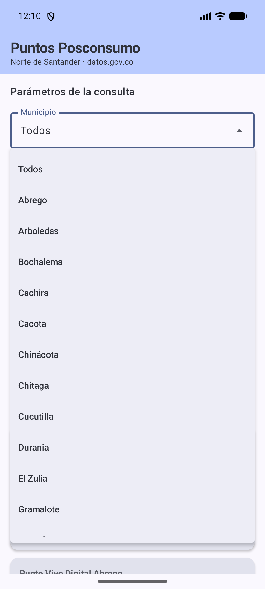 | 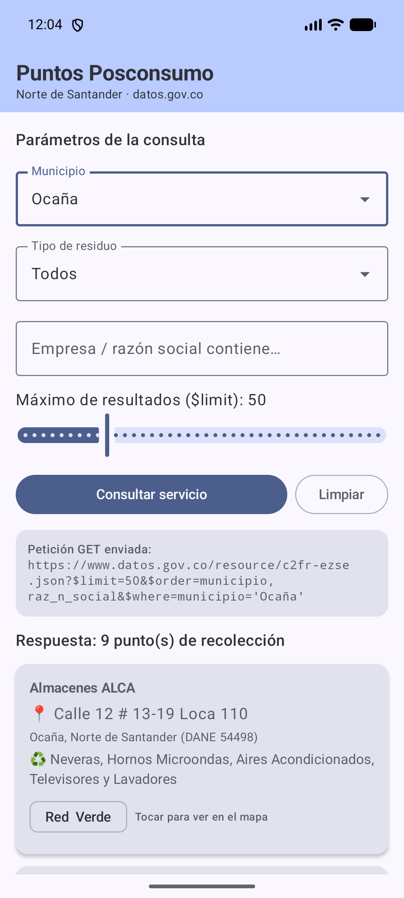 |

### 1.3 Filtrar por tipo de residuo

1. Toca el campo **Tipo de residuo**. Aparecen los 5 tipos que maneja el servicio:
   - Batería de portátil, celular y pilas
   - Baterías de plomo ácido de moto y carro
   - Envases y empaques de plaguicidas domésticos
   - Neveras, hornos microondas, aires acondicionados, televisores y lavadoras
   - Portátiles, computadores y sus periféricos
2. Elige uno (por ejemplo, *Portátiles, Computadores y sus periféricos*).
3. Pulsa **Consultar servicio**.

| Lista de tipos de residuo | Resultado: Portátiles (10 puntos) |
|---|---|
| 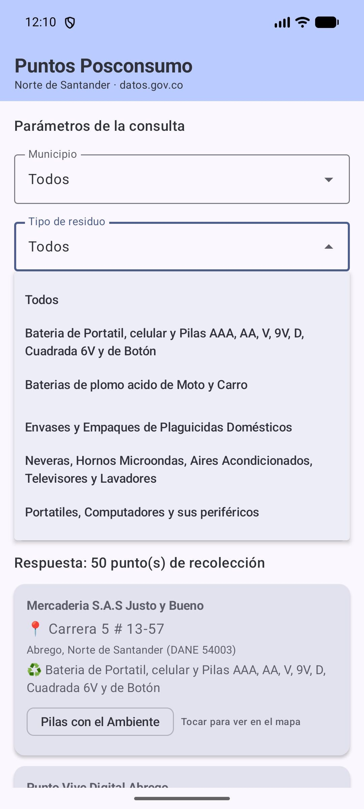 | 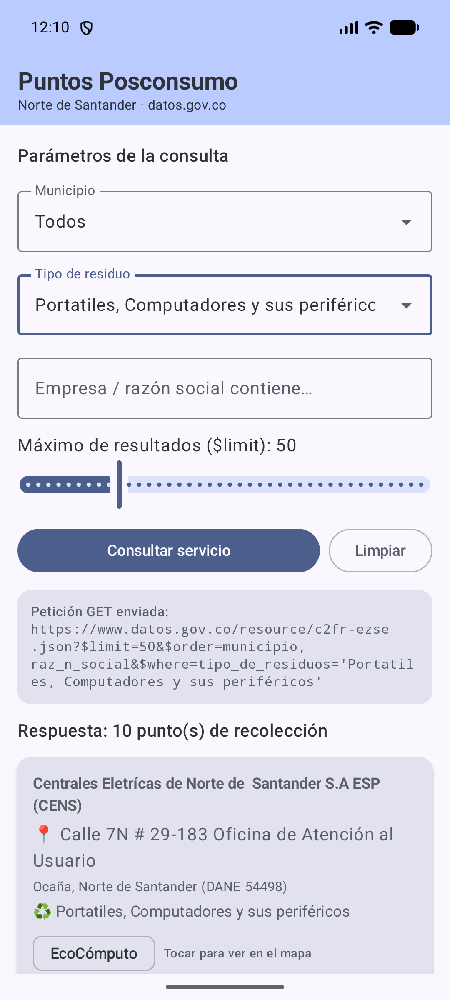 |

### 1.4 Buscar por empresa (razón social)

1. Escribe una parte del nombre de la empresa en **Empresa / razón social contiene…** (por ejemplo, `plaza`).
2. Pulsa **Consultar servicio**.

No importan las mayúsculas: la app convierte el texto a mayúsculas y le envía al servicio
`upper(raz_n_social) like '%PLAZA%'`. En este ejemplo aparecen los centros comerciales *Jardín Plaza* y *Ventura Plaza*.

| Escribiendo el texto | Resultado: "plaza" (7 puntos) |
|---|---|
| 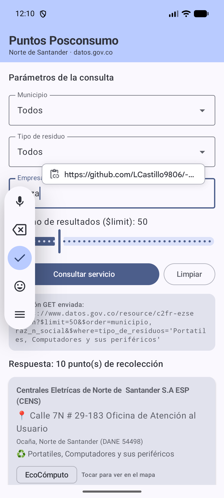 | 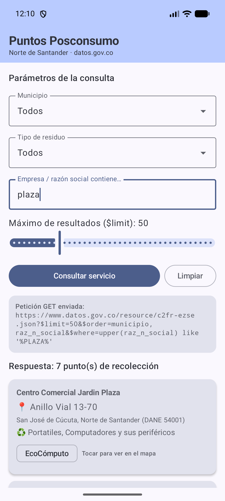 |

### 1.5 Limitar la cantidad de resultados (`$limit`)

Mueve el control deslizante **Máximo de resultados** entre 5 y 200, en pasos de 5.
Ese valor se envía como `$limit`. En el ejemplo se dejó en 10 y el servicio respondió con 10 puntos exactamente.

| Límite = 10 |
|---|
| 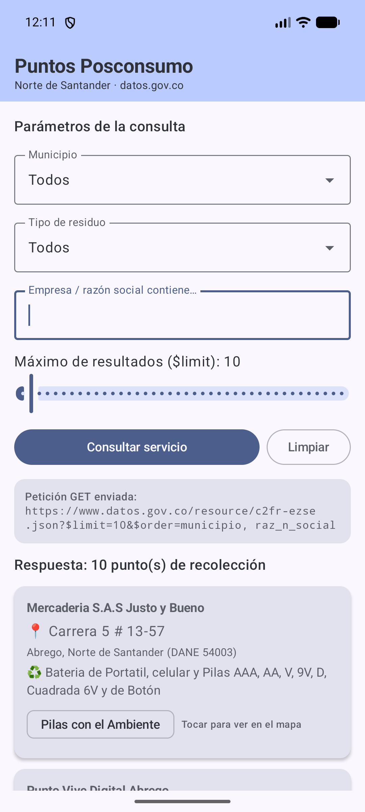 |

### 1.6 Combinar filtros

Los filtros se pueden usar juntos. La app los une con `AND` dentro del `$where`.
En el ejemplo se buscan los puntos de **San José de Cúcuta** que reciben **envases de plaguicidas domésticos**, y el servicio responde con 13 puntos.

| Municipio + tipo de residuo |
|---|
| 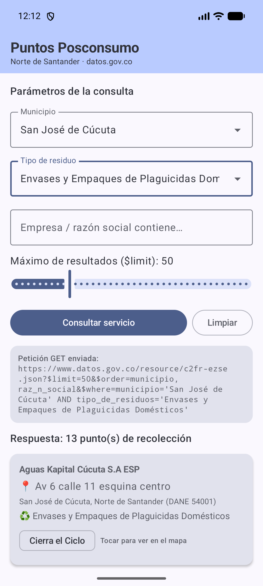 |

### 1.7 Recorrer la lista de resultados

Desliza hacia arriba para ver todas las tarjetas. Cada una muestra:

- **Razón social** de la empresa (en negrilla)
- 📍 **Dirección**
- **Municipio, departamento** y **código DANE**
- ♻️ **Tipo de residuo** que recibe
- **Programa posconsumo** (por ejemplo: *Pilas con el Ambiente*, *EcoCómputo*, *Red Verde*, *Cierra el Ciclo*)

| Lista de resultados |
|---|
| 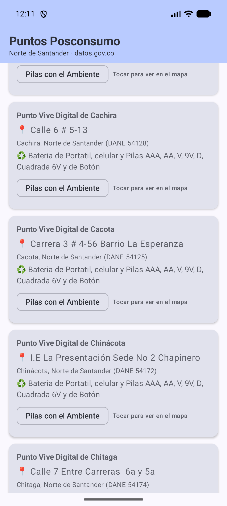 |

### 1.8 Ver un punto en el mapa

Toca cualquier tarjeta. La app abre la aplicación de mapas del teléfono (Google Maps) y busca la dirección del punto.

| Punto abierto en Google Maps |
|---|
| 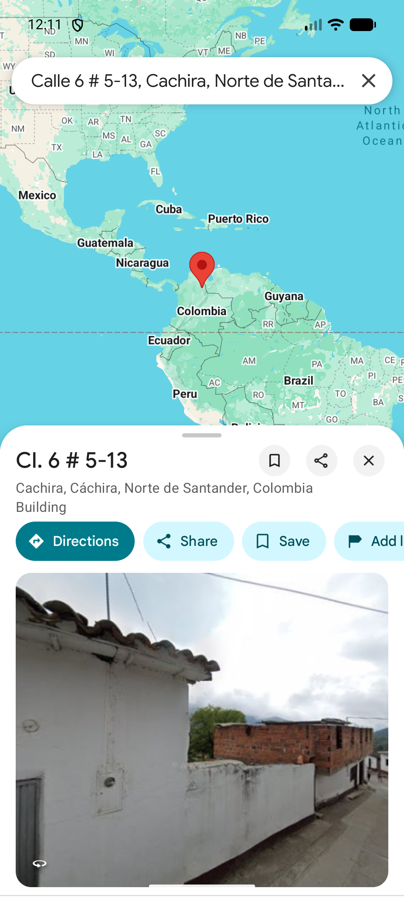 |

### 1.9 Consulta sin resultados

Si ningún punto cumple los filtros, la app muestra el mensaje *"No hay puntos que cumplan con los filtros."*

| Sin resultados |
|---|
| 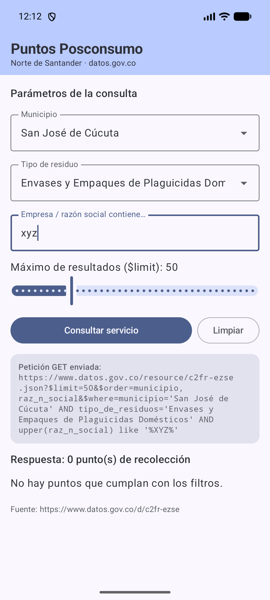 |

### 1.10 Limpiar los filtros

El botón **Limpiar** deja los filtros en sus valores por defecto: municipio *Todos*, tipo *Todos*, texto vacío y límite 50.
Después de limpiar, pulsa **Consultar servicio** para hacer una consulta nueva.

| Después de pulsar Limpiar |
|---|
| 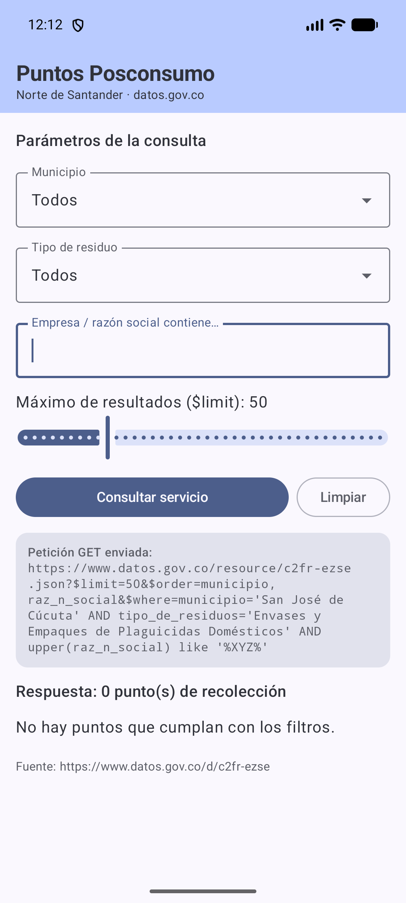 |

### 1.11 Manejo de errores (sin Internet)

Si el teléfono no tiene conexión o el servicio no responde, la app no se cierra: muestra el error en rojo.
Para tomar este pantallazo se apagaron el Wi-Fi y los datos del emulador.

| Error sin conexión |
|---|
| 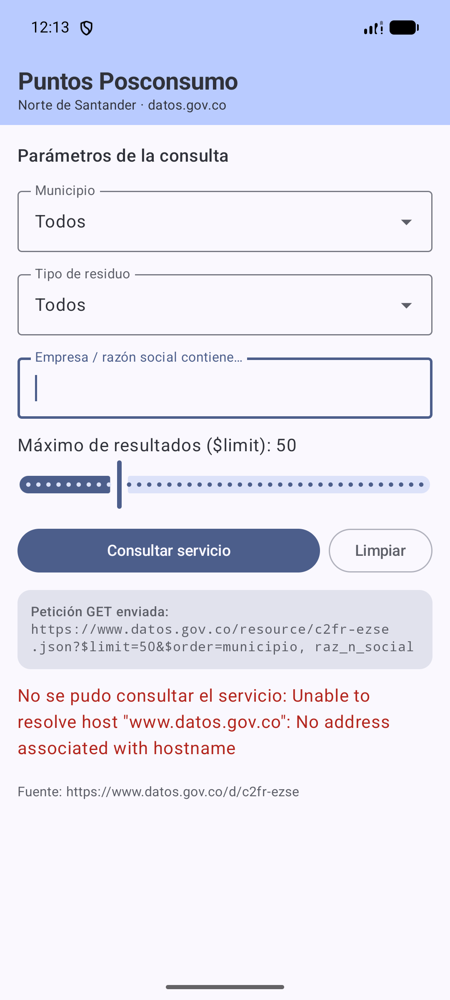 |

---

## Parte 2 – Cómo se desarrolló

### 2.1 Requisitos del reto

| Requisito | Cómo se cumple |
|---|---|
| Elegir un conjunto de datos de datos.gov.co | *Puntos de recolección de aparatos eléctricos y electrónicos en Norte de Santander* (`c2fr-ezse`), sobre programas posconsumo como en el ejemplo del reto |
| Consumir el servicio web del conjunto de datos | Peticiones HTTP GET a la API SODA `https://www.datos.gov.co/resource/c2fr-ezse.json` |
| Interfaz que envíe parámetros al servicio | Municipio, tipo de residuo, texto de empresa y límite → `$where`, `$limit`, `$order` |
| Mostrar la respuesta del servicio | Petición enviada, número de resultados y una tarjeta por punto |
| Procesar el JSON con el objeto JSON del SDK de Android | `org.json.JSONArray` y `org.json.JSONObject`, sin librerías externas |

### 2.2 Paso 1 – Elegir el conjunto de datos

El enlace del ejemplo del reto (*Puntos Posconsumo* del Ministerio de Ambiente) usa goo.gl, un servicio que ya no existe.
Por eso se buscó un conjunto de datos equivalente con la API de catálogo de datos.gov.co:

```
https://api.us.socrata.com/api/catalog/v1?domains=www.datos.gov.co&q=posconsumo
```

Se eligió **`c2fr-ezse`**: 120 puntos de recolección posconsumo en 25 municipios de Norte de Santander.

- Documentación: https://www.datos.gov.co/d/c2fr-ezse
- Endpoint JSON: https://www.datos.gov.co/resource/c2fr-ezse.json

Así se ve la respuesta del servicio en el navegador del emulador (con `$limit=3`):

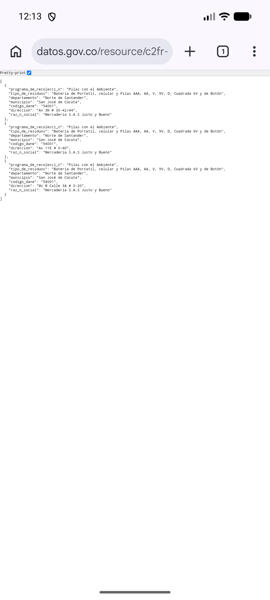

Campos de cada registro:

| Campo JSON | Significado |
|---|---|
| `raz_n_social` | Empresa o entidad |
| `direccion` | Dirección del punto |
| `municipio` | Municipio |
| `departamento` | Departamento |
| `codigo_dane` | Código DANE del municipio |
| `tipo_de_residuos` | Residuo que se recibe |
| `programa_de_recolecci_n` | Programa posconsumo |

### 2.3 Paso 2 – Diseñar la consulta (API SODA)

datos.gov.co usa la plataforma Socrata, que acepta parámetros de consulta parecidos a SQL:

| Parámetro | Uso en la app | Ejemplo |
|---|---|---|
| `$where` | Filtros combinados con `AND` | `municipio='Ocaña' AND tipo_de_residuos='…'` |
| `$limit` | Máximo de registros | `$limit=50` |
| `$order` | Orden de los resultados | `$order=municipio, raz_n_social` |
| `$select` + `$group` | Valores distintos para llenar los filtros | `$select=municipio&$group=municipio` |

Para que una comilla en el texto no rompa la consulta, se duplica (`'` → `''`). Además, todos los parámetros se codifican con `URLEncoder`.

### 2.4 Paso 3 – Crear el proyecto y dar permiso de Internet

- Proyecto nuevo en Android Studio: *Empty Activity* (Jetpack Compose), paquete `co.edu.unal.myapplication`, minSdk 24.
- En `AndroidManifest.xml` se agregó el permiso:

```xml
<uses-permission android:name="android.permission.INTERNET" />
```

### 2.5 Paso 4 – Estructura del código

```
app/src/main/java/co/edu/unal/myapplication/
├── MainActivity.kt            ← interfaz (Jetpack Compose, Material 3)
└── data/
    ├── PuntoRecoleccion.kt    ← modelo de datos
    └── DatosGovService.kt     ← consumo del webservice + parseo JSON
```

**Flujo de una consulta:**

```
Usuario elige filtros ─► DatosGovService.construirUrl() ─► HTTP GET (HttpURLConnection, hilo IO)
                                                                 │
Tarjetas en pantalla ◄── List<PuntoRecoleccion> ◄── JSONArray / JSONObject (org.json del SDK)
```

### 2.6 Paso 5 – Modelo de datos (`PuntoRecoleccion.kt`)

```kotlin
data class PuntoRecoleccion(
    val razonSocial: String,
    val direccion: String,
    val municipio: String,
    val departamento: String,
    val codigoDane: String,
    val tipoDeResiduos: String,
    val programa: String
)
```

### 2.7 Paso 6 – Consumir el servicio (`DatosGovService.kt`)

**Petición HTTP.** Se usa `HttpURLConnection`, que viene en el SDK. La petición corre en `Dispatchers.IO` para no bloquear la interfaz:

```kotlin
private suspend fun get(url: String): String = withContext(Dispatchers.IO) {
    val conexion = URL(url).openConnection() as HttpURLConnection
    try {
        conexion.requestMethod = "GET"
        conexion.connectTimeout = 15_000
        conexion.readTimeout = 15_000
        conexion.setRequestProperty("Accept", "application/json")
        if (conexion.responseCode != HttpURLConnection.HTTP_OK) throw IOException("HTTP ${conexion.responseCode}")
        conexion.inputStream.bufferedReader(Charsets.UTF_8).use { it.readText() }
    } finally {
        conexion.disconnect()
    }
}
```

**Procesamiento del JSON con `org.json` (requisito del reto).** El servicio devuelve un arreglo JSON. Cada elemento es un objeto que se convierte en un `PuntoRecoleccion`:

```kotlin
suspend fun buscarPuntos(url: String): List<PuntoRecoleccion> {
    val json = JSONArray(get(url))
    val resultado = ArrayList<PuntoRecoleccion>(json.length())
    for (i in 0 until json.length()) {
        val o: JSONObject = json.getJSONObject(i)
        resultado += PuntoRecoleccion(
            razonSocial    = o.optString("raz_n_social", "Sin nombre"),
            direccion      = o.optString("direccion", "Sin dirección"),
            municipio      = o.optString("municipio"),
            departamento   = o.optString("departamento"),
            codigoDane     = o.optString("codigo_dane"),
            tipoDeResiduos = o.optString("tipo_de_residuos"),
            programa       = o.optString("programa_de_recolecci_n")
        )
    }
    return resultado
}
```

Se usa `optString` en lugar de `getString` para que un registro al que le falte un campo no genere una excepción.

**Construcción de la URL con los parámetros del usuario:**

```kotlin
fun construirUrl(municipio: String?, tipoResiduo: String?, textoEmpresa: String, limite: Int): String {
    val condiciones = mutableListOf<String>()
    if (!municipio.isNullOrBlank())   condiciones += "municipio='${escapar(municipio)}'"
    if (!tipoResiduo.isNullOrBlank()) condiciones += "tipo_de_residuos='${escapar(tipoResiduo)}'"
    if (textoEmpresa.isNotBlank())
        condiciones += "upper(raz_n_social) like '%${escapar(textoEmpresa.trim().uppercase())}%'"
    // + $limit, $order y $where (si hay condiciones) → codificados con URLEncoder
    ...
}
```

### 2.8 Paso 7 – Interfaz (`MainActivity.kt`)

La pantalla está hecha con **Jetpack Compose + Material 3**:

- `TopAppBar` con el título y la fuente de los datos.
- Dos `ExposedDropdownMenuBox` para municipio y tipo de residuo. Sus opciones se llenan con la respuesta del servicio.
- `OutlinedTextField` para el texto de la empresa.
- `Slider` para `$limit`.
- Botones **Consultar servicio** y **Limpiar**.
- Una `Card` que muestra la petición GET enviada, decodificada para que se pueda leer.
- Un `LazyColumn` con una `Card` por resultado. Al tocar una tarjeta se lanza un `Intent` `geo:0,0?q=<dirección>` para abrir la app de mapas.
- Estados de la pantalla: cargando (`CircularProgressIndicator`), error (texto en rojo), sin resultados y lista de resultados.

Las llamadas al servicio se hacen con corrutinas:

- `LaunchedEffect(Unit)` hace la carga inicial: municipios, tipos y la primera consulta.
- `rememberCoroutineScope().launch { … }` atiende el botón **Consultar servicio**.

### 2.9 Paso 8 – Compilar y probar en el emulador

```bash
./gradlew assembleDebug
adb install -r app/build/outputs/apk/debug/app-debug.apk
adb shell am start -n co.edu.unal.myapplication/.MainActivity
```

Para comprobar que la app funciona bien, se comparó lo que mostraba con consultas hechas directamente al servicio:

| Prueba | Esperado (servicio) | App |
|---|---|---|
| Sin filtros, límite 50 | 50 | 50 ✅ |
| Municipio = Ocaña | 9 | 9 ✅ |
| Tipo = Portátiles, computadores… | 10 | 10 ✅ |
| Empresa contiene "plaza" | 7 | 7 ✅ |
| Cúcuta + Envases de plaguicidas | 13 | 13 ✅ |
| Límite = 10 | 10 | 10 ✅ |
| Texto "xyz" | 0 | 0 (mensaje) ✅ |
| Sin Internet | error | mensaje de error ✅ |

### 2.10 Tecnologías

- Kotlin, Jetpack Compose, Material 3
- `HttpURLConnection` (SDK de Android) para HTTP
- `org.json.JSONArray` / `org.json.JSONObject` (SDK de Android) para JSON
- Corrutinas de Kotlin (`Dispatchers.IO`)
- API SODA (Socrata) de datos.gov.co
- Android Studio + emulador Pixel 8
