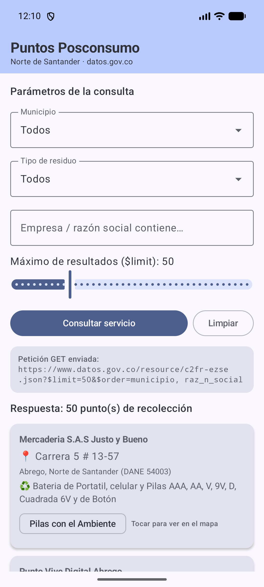
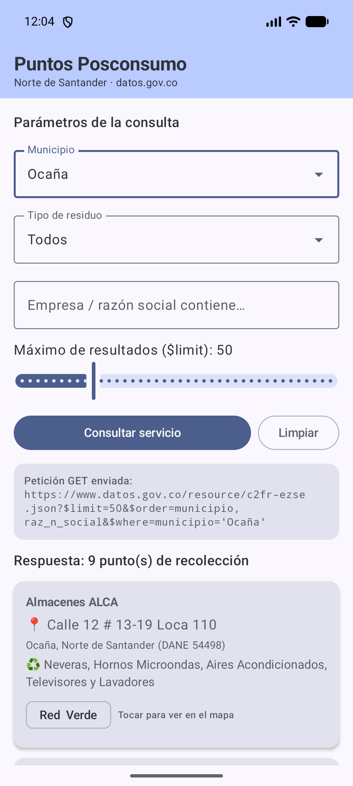
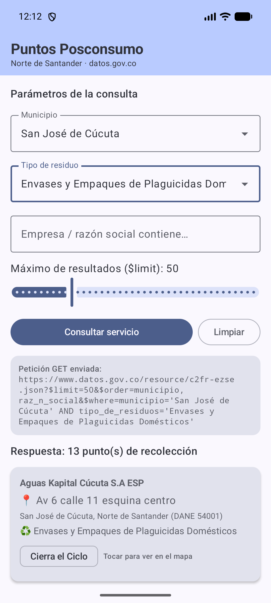

# ♻️ Reto 10 – Consumiendo Webservices del Catálogo de Datos Colombiano

> **Curso:** Desarrollo de Aplicaciones para Dispositivos Móviles · Universidad Nacional de Colombia
> **Autor y desarrollador:** Luis Alberto Castillo Sanabria
> **Plataforma:** Android (Kotlin + Jetpack Compose)

Aplicación Android (Kotlin + Jetpack Compose) que consume el servicio web de
[datos.gov.co](https://www.datos.gov.co) del conjunto de datos
**Puntos de recolección de Aparatos eléctricos y electrónicos en el departamento Norte de Santander**
(programas posconsumo: pilas, baterías, computadores, electrodomésticos, envases de plaguicidas, etc.).

- Documentación del dataset: https://www.datos.gov.co/d/c2fr-ezse
- Endpoint JSON (API SODA): https://www.datos.gov.co/resource/c2fr-ezse.json

## Funcionalidad

- Al abrir la app se consultan al servicio los **municipios** y **tipos de residuo** disponibles (`$select` + `$group`) para llenar los filtros.
- La interfaz permite enviar parámetros al servicio:
  - Municipio (`$where municipio='…'`)
  - Tipo de residuo (`$where tipo_de_residuos='…'`)
  - Texto en la razón social (`upper(raz_n_social) like '%…%'`)
  - Máximo de resultados (`$limit`)
- Se muestra la petición GET enviada y la respuesta: cada punto con empresa, dirección, municipio, código DANE, tipo de residuo y programa.
- Al tocar un punto se abre su dirección en la app de mapas.

## Implementación

- `data/DatosGovService.kt`: arma la URL, hace la petición con `HttpURLConnection` (en `Dispatchers.IO`) y procesa la respuesta **con `org.json.JSONArray` / `JSONObject` del SDK de Android**, como pide el reto.
- `data/PuntoRecoleccion.kt`: modelo de datos.
- `MainActivity.kt`: interfaz en Compose (Material 3).
- Permiso `INTERNET` en el `AndroidManifest.xml`.

## Capturas (emulador Pixel 8)

| Consulta inicial | Filtro por municipio | Filtros combinados |
|---|---|---|
|  |  |  |

📘 **Manual de uso y de desarrollo con pantallazos de todas las funciones: [MANUAL.md](MANUAL.md)**

## Ejecutar

Abrir el proyecto en Android Studio y ejecutar en un emulador o dispositivo con acceso a Internet.

## Autoría

Desarrollado por **Luis Alberto Castillo Sanabria** ([@LCastillo9806](https://github.com/LCastillo9806)) para el curso *Desarrollo de Aplicaciones para Dispositivos Móviles* de la **Universidad Nacional de Colombia**.
